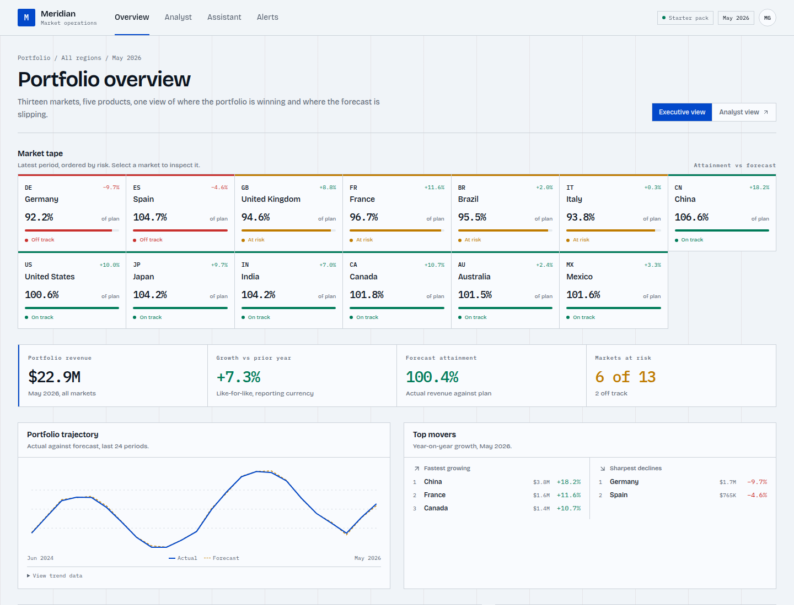
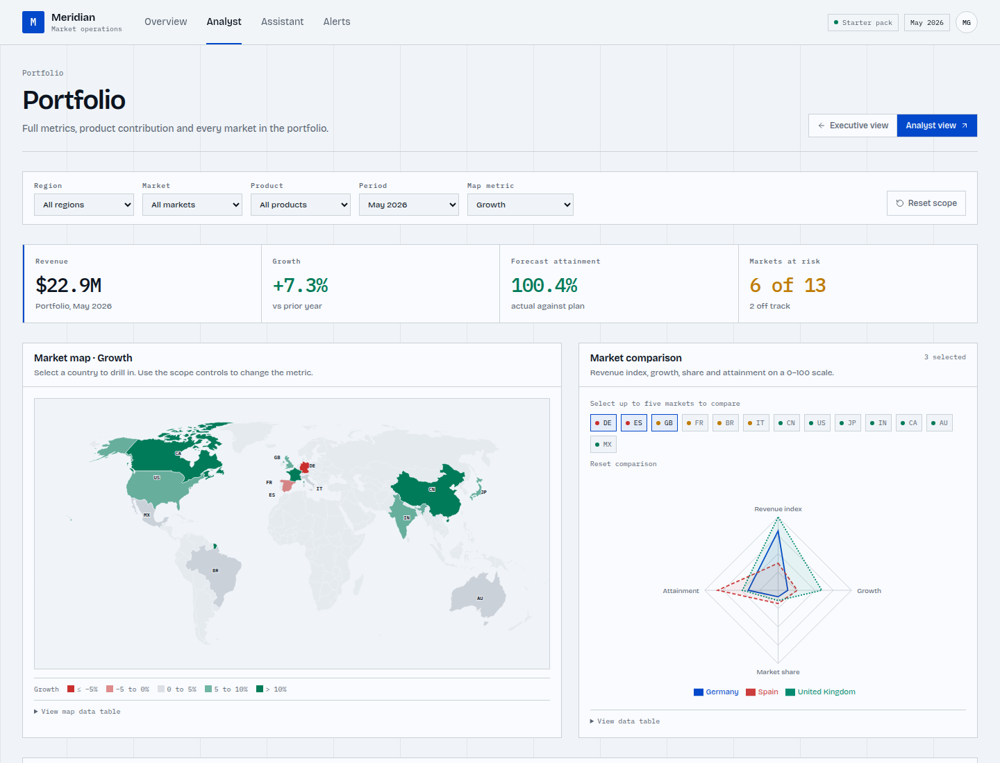
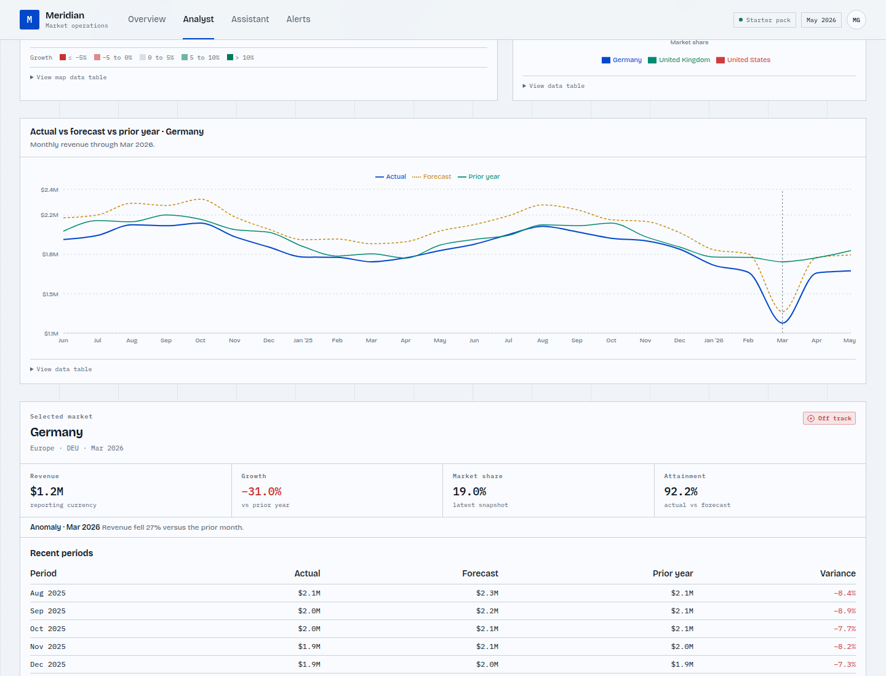
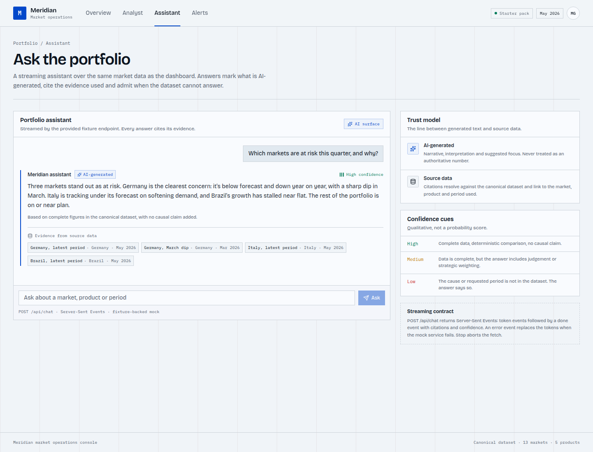
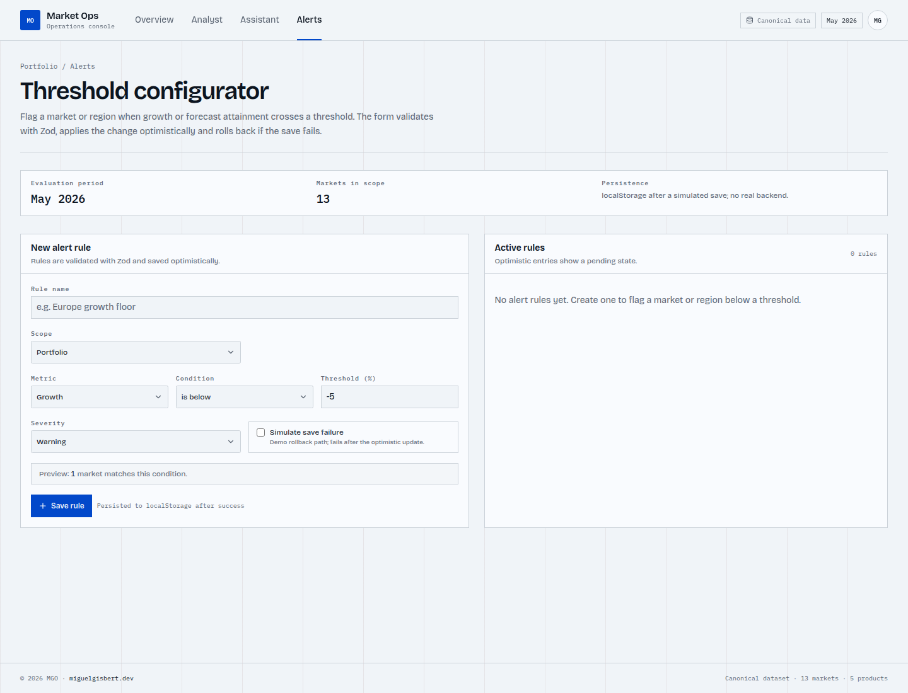
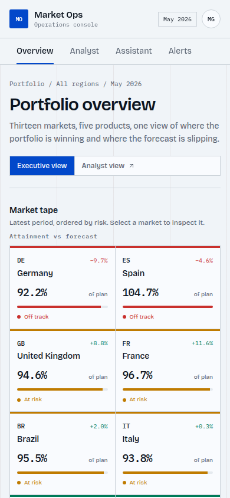

# Meridian — Market operations console

A front-end for a commercial operations team that reads portfolio performance and
asks questions about it. Built for the Front-End Engineer take-home assignment
using the provided starter pack.

**Live:** [https://meridian-market-ops.vercel.app](https://meridian-market-ops.vercel.app)

**Stack:** Next.js 16 (App Router), React 19, TypeScript strict, Tailwind CSS v4,
shadcn/ui, Zod, Recharts, Biome, Vitest and Playwright.

## Quick setup

```bash
npm install
npm run dev
```

Open [http://localhost:3000](http://localhost:3000).

```bash
npm run lint        # Biome lint + format check
npm run typecheck   # next typegen + tsc --noEmit
npm test            # Vitest unit/component tests
npm run test:e2e    # Playwright happy paths (Chrome)
npm run build       # production build
npm audit           # 0 vulnerabilities
```

## What it does

### Executive overview (`/`)

- Market tape ordered by risk, with status, growth and forecast attainment.
- Portfolio totals, trend against forecast, top movers and markets at risk.
- Dense market table with revenue, growth, share, attainment and status.
- "Needs attention" panel driven by the dataset's statuses and anomaly markers.

### Analyst workspace (`/analyst`)

- Drill-down through portfolio → region → market → product.
- Choropleth map coloured by growth, attainment, share or revenue, with click-to-drill
  and automatic zoom to the selected region.
- Radar comparison of up to five markets across revenue index, growth, share and
  attainment.
- 24-period actual vs forecast vs prior-year time series for the selected scope.
- Forecast-variance heat map (markets × periods), keyboard-navigable with roving
  tab focus; selecting a cell updates the rest of the dashboard.
- Region, product, period and comparison controls, all reflected in the URL.
- Accessible data tables behind every visualisation.

### Assistant (`/assistant`)

- Real `POST /api/chat` SSE transport implementing the starter-pack contract.
- Token-by-token rendering, in-progress state, stop via `AbortController`.
- Citations resolved against `data.json` and linked to the analyst view.
- Confidence cues, explicit abstention, error state and long-response handling.
- AI-generated narrative is visually and structurally separate from authoritative
  source data.

### Alerts (`/alerts`)

- Non-trivial threshold configurator for growth or forecast attainment.
- Zod schema validation with inline field errors.
- Optimistic save, simulated failure mode, rollback and localStorage persistence.
- Rule list with active/paused state and delete.

## Screenshots

### Portfolio overview



### Analyst workspace



### Time series and heat map



### Assistant with citations



### Alert configurator



### Mobile



## Starter pack alignment

The canonical files from the starter pack are copied to `src/data/`:

- `data.json`: 13 markets, 4 regions, 5 products and 1,560 rows (market × product ×
  24 months). Region and portfolio totals are derived from the fact table.
- `fixtures.json`: served by `src/app/api/chat/route.ts`; first keyword match wins,
  with the provided default fallback.

The provided data and streaming contract are retained at
[`docs/starter-pack-contract.md`](docs/starter-pack-contract.md). The synthetic
dashboard data is no longer used. `src/lib/data/schema.ts` validates the JSON at
module load, including every series row's market, product and period reference.

## Architecture

```text
Browser
├── Server Components
│   ├── overview page          reads DataIndex, renders static dashboard
│   ├── analyst page           awaits searchParams, renders scope + charts
│   └── app shell              dataset metadata, navigation
├── Client islands
│   ├── charts                 Recharts radar/line, custom SVG map/heat map
│   ├── scope controls         URL updates through the App Router
│   ├── assistant              fetch + SSE parser + AbortController
│   └── alert configurator     Zod form, optimistic state, rollback
└── POST /api/chat
    └── fixtures.json lookup → token SSE events → done event
```

```text
src/
  app/
    page.tsx                  executive overview
    analyst/page.tsx          analyst workspace + Suspense boundary
    assistant/page.tsx        chat surface + trust model
    alerts/page.tsx           threshold configurator
    api/chat/route.ts         SSE fixture endpoint
    error.tsx / not-found.tsx resilience states
  components/
    charts/                   map, radar, time series, heat map, chart panel
    dashboard/                tape, KPI band, tables, trend, scope controls
    analyst/                  region/product tables, selected market panel
    assistant/                streaming chat
    alerts/                   alert form and rule list
    ui/                       shadcn primitives
  lib/
    data/
      schema.ts               Zod data contract and inferred types
      build.ts                immutable DataIndex (aggregations precomputed)
      selectors.ts            portfolio, region, market, product, radar, heatmap
    chat/
      schema.ts               fixtures + SSE event contract
      citations.ts            citation lookup and URL resolution
    alerts/schema.ts          form schema and threshold predicates
    dashboard/config.ts       map metric config
    format.ts                 deterministic currency/percent/date formatting
  data/
    data.json                 canonical dataset
    fixtures.json             canonical assistant fixtures
    world-map.json            generated SVG paths and country bounds
scripts/generate-world-map.mjs
```

### Data flow

`data.json` → Zod validation → `createDataIndex` → selectors → Server Components →
props to client visualisations. The index is built once at module load. Every series
is pre-aggregated by market, region, product, market×product and region×product so
dashboard renders do not repeatedly scan the fact table.

### State boundaries

- **Server/data state:** the immutable validated dataset and precomputed index.
- **URL state:** current region, market, product, period, map metric and radar
  comparison. This is the source of truth for the dashboard, which makes views
  shareable and keeps back/forward working.
- **Client state:** chart focus/roving tab index, chat stream and abort controller,
  alert form fields and optimistic rule state. No server data is duplicated into
  client state.

## Approach and decisions

### Framework and styling

Next.js App Router with React Server Components keeps the dataset and aggregation
out of the client bundle. TypeScript strict mode plus Zod-derived types gives one
contract from JSON to UI. shadcn/ui provides accessible primitives, but the visual
system is custom: cool operational palette, Bricolage Grotesque + IBM Plex Mono,
hairline structure, signal tape, squared panels and a dense table-first layout.
Tokens live in `src/app/globals.css` and are consumed by Tailwind/shadcn.

### Streaming

The chat uses the documented SSE contract directly through streaming `fetch` rather
than `EventSource` (which is GET-only). A typed discriminated union parses every
event. `AbortController` powers Stop; tokens are appended incrementally; the final
done event supplies citations and confidence. Malformed/partial streams end in an
explicit error state rather than an invented answer.

### Trust surface

- AI narrative carries an explicit "AI-generated" label.
- Citations are rendered separately under "Evidence from source data", with dataset
  IDs resolved to market/region/product/period labels and analyst links.
- Confidence is qualitative and paired with an explanation, not a fake probability.
- Abstentions say explicitly that nothing was extrapolated.
- Transport failures are labelled as assistant errors, not data conclusions.
- Model output is rendered as text; there is no `dangerouslySetInnerHTML`.

### Data visualisation

- **Map:** custom SVG paths generated at development time from `world-atlas` with
  `d3-geo`; the runtime receives only path data. Links are real SVG anchors, so map
  markets are keyboard reachable. The map zooms to the active region and has a data
  table alternative.
- **Radar:** Recharts, with colour plus dash patterns for each series, a 0–100
  normalised scale and raw values in a table.
- **Time series:** Recharts, dashed/solid distinctions plus a full data table.
- **Heat map:** custom semantic table with roving tabindex, arrow-key navigation and
  signed values in every cell, so colour is never the only signal.
- **Overview trend:** lightweight SVG to avoid shipping a chart library for a
  two-line thumbnail.

### Coordinated views and URL state

The URL carries the drill path and filters. Selecting a country, region, product,
period or heat-map cell produces a URL that the server resolves into a new scope.
All panels read from that scope, so map, radar, time series, tables and KPI band stay
coordinated. The analyst route is partially prerendered: a Suspense fallback provides
a fast shell while `searchParams` resolves the selected scope.

### Forms

The alert form uses a Zod schema, typed field errors and accessible descriptions.
The optimistic rule is inserted immediately, then confirmed or rolled back after the
simulated save. A deliberate "Simulate save failure" control makes the rollback path
demonstrable and testable.

## Accessibility

Targeted at WCAG 2.1 AA:

- Semantic landmarks, one `h1` per page, skip link, labelled navigation and controls.
- Visible focus styles throughout; map links and heat-map cells are keyboard
  reachable; heat map supports arrow keys, Home and End.
- Text labels and icons accompany every status colour; chart series use line styles
  and dash patterns in addition to colour.
- Every chart has a data-table equivalent through `<details>`; the heat map is itself
  a semantic table with signed values in every cell.
- Screen-reader announcements for chat generation state, form errors and save/rollback.
- Reduced-motion support for the streaming caret; chart animations are disabled.
- Currency, percentages and periods use shared formatters; dates are pinned to UTC.
- No colour-only status signals; status text is always present.
- **Would add with more time:** automated axe checks in CI, a screen-reader pass on
  the full assistant flow, and a forced-colors mode review.

## Testing

```bash
npm test        # Vitest: 4 files, 11 tests
npm run test:e2e
```

Covered:

- Data index/selectors: fact-table totals, canonical statuses, product drill-down,
  heat-map dimensions, top-mover direction, sorted products, radar bounds.
- Citation resolution: explicit labels, dataset-ID fallback and generated URLs.
- `StatusBadge`: every status renders text, not just colour.
- Alert configurator: schema rejection, optimistic save and rollback on forced failure.
- Playwright: overview → market drill-down → assistant citation; alert save and
  forced rollback.
- Build, typecheck, lint and `npm audit` are clean.

Deliberately skipped for time: visual regression tests, full keyboard traversal E2E
for every chart, axe/Lighthouse CI budgets, and unit tests for Recharts internals.

## Productionising

- **Performance:** server-rendered data and selectors; client-only interactive islands;
  no chart animation; 24-period tables are scrollable rather than virtualised; map is
  pre-generated so no topology library ships to the browser. The heaviest client
  chunks are Recharts and the map path data.
- **Observability:** Vercel Speed Insights is mounted in the root layout and
  collects web-vitals on the live deployment. The error boundary at
  `src/app/error.tsx` captures render failures; the next step is an error-tracking
  vendor such as Sentry.
- **Resilience and hardening:** Zod validation at the data and SSE boundaries;
  explicit error/abstain states; AbortController cleanup; no HTML injection; strict
  TypeScript; deterministic formatters to avoid hydration drift.
- **Build and serving:** `next build` produces static overview/alerts/assistant pages,
  a partially prerendered `/analyst` and a dynamic `/api/chat`; SSE responses set
  `no-cache, no-transform` and disable proxy buffering.
- **CI/CD:** `.github/workflows/ci.yml` runs install, lint, typecheck, unit tests and
  build; a second job runs Playwright against a production server. The live Vercel
  deployment was produced from this repository.

## Key decisions and standards

Followed:

- Strict TypeScript, no `any`, Zod schemas and inferred types.
- Immutable data index and pure selectors; no duplicate server data in client state.
- URL as dashboard source of truth; Suspense for request-time scope.
- Accessible tables behind charts; deterministic number formatting for hydration.
- Biome for lint/format, Vitest/Testing Library, Playwright, GitHub Actions.
- Demo data and fixtures stay in the repository; the binary assignment brief does
  not.

Skipped or deferred:

- Real auth/SSO and role-based UI (explicitly out of scope; mock identity only).
- Real LLM/RAG backend (explicitly out of scope).
- Virtualised table, live-updating mode, command palette and Storybook (optional
  stretch goals).
- Vendor observability until a deployment target is chosen.

## AI-assisted development

AI was used as a pair programmer for scaffolding, refactoring, accessibility checks
and test generation, with the following working rules:

- Read the provided contract and docs first; do not invent backend behaviour.
- Keep the human in charge of product and visual decisions; review every diff.
- Prefer typed interfaces and schema validation over free-form object shapes.
- Run lint, typecheck, unit tests, E2E and build after every substantial change.
- Never ship unreviewed generated code; do not use AI to write the reasoning in this
  README wholesale.

## Known limitations / what I'd do differently with more time

- Replace canned fixture answers with the real model once the backend exists.
- Move alert persistence from localStorage to a real service with retries.
- Use the canonical share snapshot consistently or recompute a documented share
  definition for every period.
- Add an accessible scatter/bubble view and a region-vs-region radar mode.
- Add Lighthouse bundle budgets, error tracking and a full axe pass.
- Add a command palette and a context-aware assistant once the URL scope is stable.
- Add the optional live mode and a virtualised analyst table.
